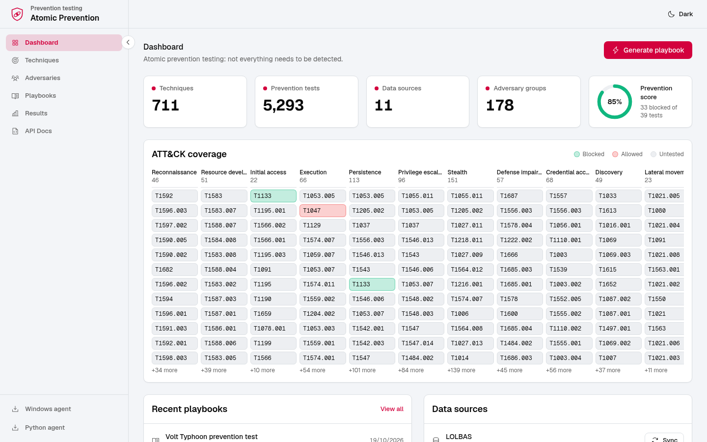
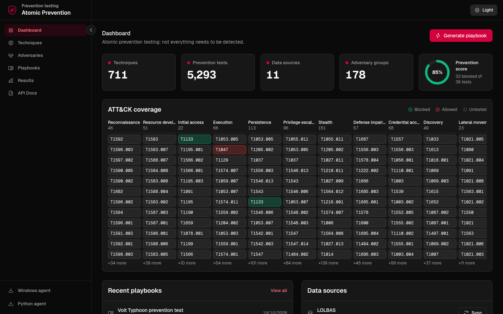
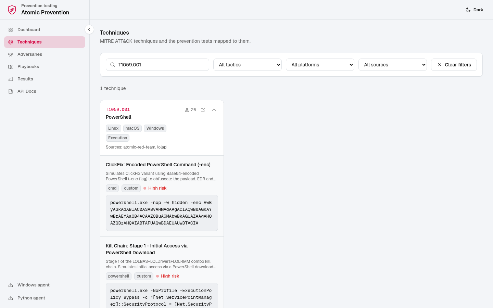
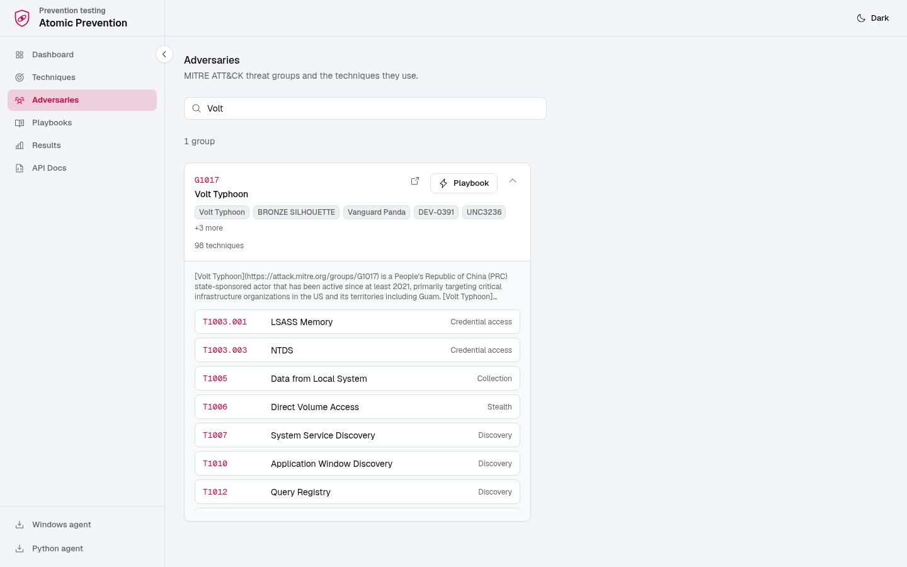
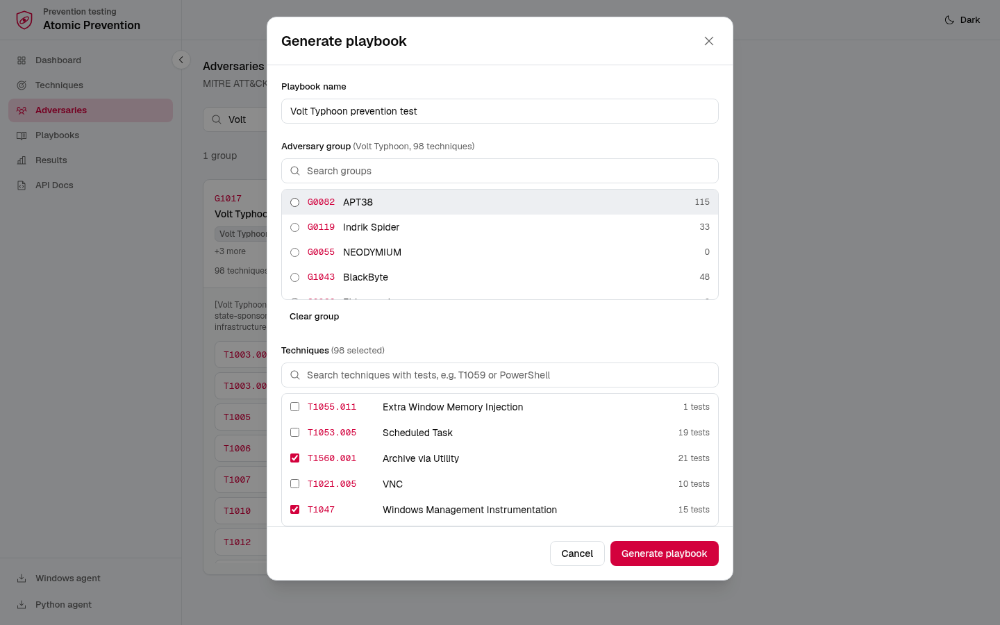
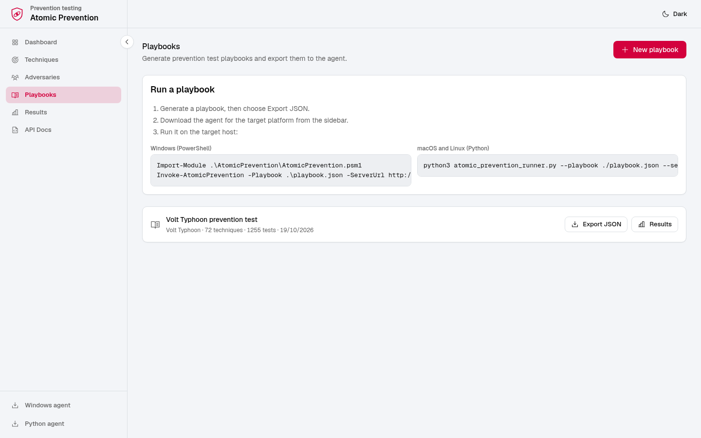
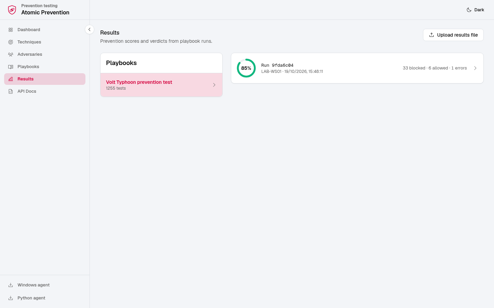
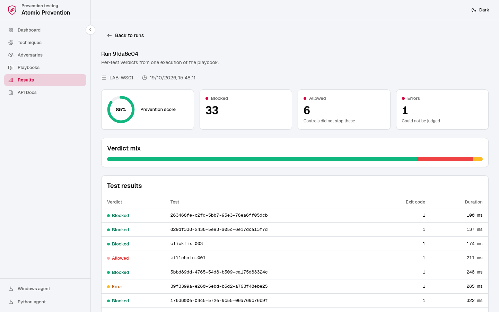
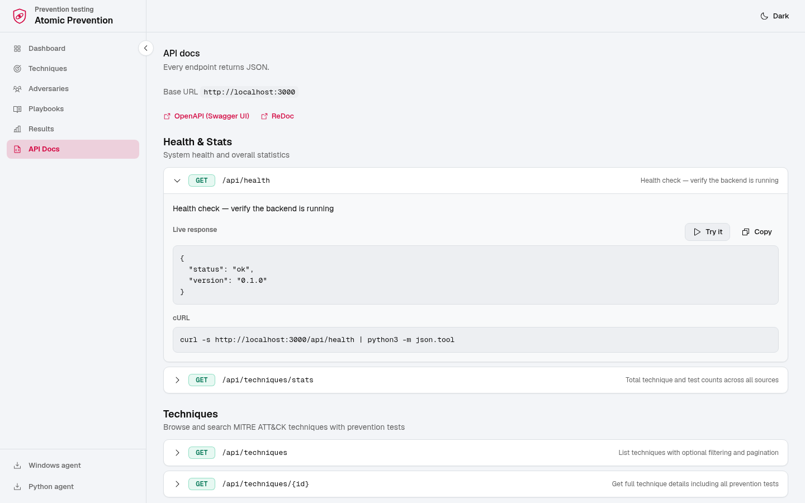
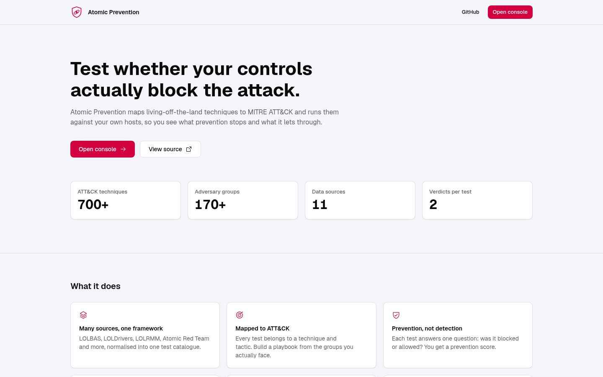

# Atomic Prevention

**Prevention-focused LOL testing framework mapped to MITRE ATT&CK.**

Atomic Prevention takes the concept of [Atomic Red Team](https://github.com/redcanaryco/atomic-red-team) and flips it: instead of testing *detection*, it tests whether your **preventative controls actually block** living-off-the-land techniques.

It aggregates multiple LOL projects ([LOLBAS](https://lolbas-project.github.io/), [LOLDrivers](https://www.loldrivers.io/), [LOLRMM](https://lolrmm.io/)) alongside Atomic Red Team tests, maps everything to [MITRE ATT&CK](https://attack.mitre.org/), and generates adversary-group-specific playbooks you can run to validate your security controls.

---

## How It Works

```
┌──────────────┐     ┌──────────────────┐     ┌──────────────────┐
│  LOL Sources │     │   MITRE ATT&CK   │     │  Adversary Intel │
│  LOLBAS      │────▶│   Technique Map   │◀────│  170+ Groups     │
│  LOLDrivers  │     │   700+ Techniques │     │  Volt Typhoon,   │
│  LOLRMM      │     └────────┬─────────┘     │  APT29, FIN7...  │
│  Atomic RT   │              │               └──────────────────┘
│  Custom      │              ▼
└──────────────┘     ┌──────────────────┐
                     │ Playbook Engine  │
                     │ Group → Techs →  │
                     │ Prevention Tests │
                     └────────┬─────────┘
                              │
                              ▼
                     ┌──────────────────┐     ┌──────────────────┐
                     │  PowerShell      │────▶│  Results:        │
                     │  Execution Agent │     │  BLOCKED ✓       │
                     │  Run tests on    │     │  ALLOWED ✗       │
                     │  target system   │     │  Prevention %    │
                     └──────────────────┘     └──────────────────┘
```

1. **Ingest** data from LOLBAS, LOLDrivers, LOLRMM, and Atomic Red Team
2. **Map** everything to MITRE ATT&CK techniques and 170+ adversary groups
3. **Generate** a playbook targeting a specific adversary group (e.g., "What would Volt Typhoon use?")
4. **Execute** the playbook on a target system using the PowerShell agent
5. **Report** which techniques were **blocked** vs **allowed** by your controls

## Quick Start

### Option 1: Docker (Recommended)

```bash
# Clone and run
git clone https://github.com/anubhavg-icpl/atomic-prevention.git
cd atomic-prevention
docker compose up -d
```

Access the UI and API at `http://localhost:3000`. Interactive OpenAPI docs are at
`http://localhost:3000/api/docs`.

Docker Compose binds to localhost by default because the API can launch source syncs
and accept test results. Put it behind authentication before exposing it publicly; for
an explicitly trusted lab network, set `MA_HOST=0.0.0.0`.

> [!CAUTION]
> Atomic Prevention executes real adversary-simulation commands. Run it only on systems
> you own or are explicitly authorized to test. Start with a dry run and use isolated
> lab hosts before testing production controls.

On first startup, the backend automatically:
- Downloads the full MITRE ATT&CK STIX dataset (700+ techniques, 170+ groups)
- Seeds adversary group → technique mappings
- Seeds custom ClickFix and kill chain prevention tests

Then sync the LOL data sources (or use the UI):

```bash
# Sync all data sources
make sync
```

### Option 2: Local Development

```bash
# Backend (from the repository root)
python3 -m venv .venv
. .venv/bin/activate
pip install -r backend/requirements.txt
uvicorn backend.app.main:app --reload --port 8000

# Frontend (separate terminal)
cd frontend
npm install
NEXT_PUBLIC_API_URL=http://localhost:8000 npm run dev
```

### Running the PowerShell Agent

1. Download the agent from the UI (sidebar "Windows agent" or "Python agent" link) or the API
2. Generate a playbook from the adversaries page
3. Run it on a Windows target:

```powershell
# Import the module
Import-Module .\AtomicPrevention\AtomicPrevention.psm1

# Run a playbook
Invoke-AtomicPrevention -Playbook .\my-playbook.json

# Dry run (shows what would be tested without executing)
Invoke-AtomicPrevention -Playbook .\my-playbook.json -WhatIf

# Upload results back to the server
Invoke-AtomicPrevention -Playbook .\my-playbook.json -ServerUrl http://your-server:3000

# Test a specific vulnerable driver (BYOVD)
Test-DriverLoad -DriverName "procexp.sys" -DriverHash "ABC123..." -Methods ScExe,NewService
```

### Running on macOS / Linux (Python Agent)

A single-file, zero-dependency Python 3.8+ runner — no pip install needed:

```bash
# Download just the Python runner
curl -fL http://your-server:3000/api/agent/download-python -o atomic_prevention_runner.py

# Run a playbook
python3 atomic_prevention_runner.py --playbook ./my-playbook.json

# With result upload
python3 atomic_prevention_runner.py --playbook ./playbook.json --server http://server:3000

# Dry run
python3 atomic_prevention_runner.py --playbook ./playbook.json --dry-run

# Filter to specific techniques
python3 atomic_prevention_runner.py --playbook ./playbook.json --only-technique T1059.004
```

The Python agent includes platform-specific verdict detection:
- **macOS**: Gatekeeper blocks, XProtect, quarantine flags, TCC denials
- **Linux**: AppArmor denials, SELinux AVC, seccomp kills

## Data Sources

| Source | Tests | Description | Platform |
|--------|-------|------------|----------|
| [Atomic Red Team](https://github.com/redcanaryco/atomic-red-team) | ~1,800 | Portable tests (repurposed for prevention) | Multi |
| [LOLDrivers](https://github.com/magicsword-io/LOLDrivers) | ~900 | HVCI-bypass vulnerable drivers (BYOVD) | Windows |
| [LOLBAS](https://github.com/LOLBAS-Project/LOLBAS) | ~450 | Living Off The Land Binaries, Scripts, Libraries | Windows |
| [LOLRMM](https://github.com/magicsword-io/LOLRMM) | ~300 | Remote Monitoring & Management tools | Multi |
| [LOOBins](https://github.com/infosecB/LOOBins) | ~180 | Living Off the Orchard: macOS binaries | macOS |
| [LOLAPI](https://github.com/TheMagicClaw/LOLAPI) | ~55 | Weaponized system APIs (.NET, COM, Win32, cloud metadata) | Multi |
| [LOTTunnels](https://lottunnels.github.io/) | ~145 | Tunneling/proxy tools abused for C2 (ngrok, chisel, frp, etc.) | Multi |
| [Persistence-Info](https://github.com/persistence-info/persistence-info.github.io) | ~36 | Windows persistence mechanisms (registry, WMI, COM, services) | Windows |
| [GTFOBins](https://gtfobins.github.io/) | ~820 | Linux/Unix LOL binaries (shell, SUID, sudo, file ops) | Linux |
| [LOAS](https://github.com/cyberbuff/loas) | ~185 | Living Off Apple Systems (AppleScript, JXA, Swift compiled) | macOS |
| [Sysinternals](https://live.sysinternals.com/) | 80 | 20 tools × 4 variants: download, stage, rename, UNC exec | Windows |
| Custom | 10 | ClickFix social engineering + kill chain combos | Windows |

**Total: 4,900+ prevention tests across 700+ MITRE ATT&CK techniques.**

### LOLDrivers: HVCI Bypass Testing

Atomic Prevention focuses on drivers that **load despite HVCI** — the ~280 drivers adversaries actually use in BYOVD (Bring Your Own Vulnerable Driver) attacks. Each driver generates two tests:
- **sc.exe** — `sc.exe create type=kernel` + `sc.exe start` (most common adversary method)
- **New-Service** — PowerShell `New-Service -ServiceType KernelDriver` + `Start-Service`

Both methods include SHA256 verification and full cleanup.

### LOLRMM: Unauthorized RMM Detection

Tests whether your security stack blocks unauthorized deployment of 25+ RMM tools (AnyDesk, TeamViewer, ScreenConnect, RustDesk, etc.). Four test types per tool:
- **Download & Execute** — Can the binary be downloaded and run?
- **Execution** — Is it already installed and runnable?
- **Service** — Is an RMM service registered?
- **Network** — Can the endpoint reach RMM infrastructure?

### ClickFix Prevention Tests

Custom tests simulating the [ClickFix social engineering technique](https://attack.mitre.org/techniques/T1204/004/) (T1204.004 - Malicious Copy and Paste):
- PowerShell IWR/IEX download cradle
- mshta.exe remote HTA execution
- Base64-encoded PowerShell (-enc)
- Clipboard paste-and-execute simulation
- certutil download-and-decode

### Sysinternals Tool Abuse Testing

Adversaries frequently abuse legitimate Sysinternals tools (PsExec, ProcDump, etc.). Atomic Prevention tests 20 Sysinternals tools with 4 variants each:

| Variant | What it tests | MITRE |
|---------|--------------|-------|
| **Download & Execute** | Can the tool be fetched from `live.sysinternals.com` and run from `%TEMP%`? | T1105 |
| **Stage in Random Dir** | Does EDR detect the tool when placed in an unusual directory? | T1105 |
| **Rename & Execute** | Does EDR detect the tool when renamed (e.g., PsExec → `svchost_update.exe`)? | T1036.005 |
| **UNC Path Execution** | Can the tool run directly from `\\live.sysinternals.com\tools\`? | T1105 |

Tools include: PsExec, ProcDump, AccessChk, Autoruns, ProcMon, ADExplorer, SDelete, Handle, Sysmon, and 11 more.

### Kill Chain Combo Playbook

A 5-stage "ClickFix to Crown Jewels" playbook combining LOLBAS + LOLRMM + LOLDrivers:

| Stage | Technique | What it tests |
|-------|-----------|--------------|
| 1 | T1059.001 | PowerShell download cradle (initial access) |
| 2 | T1218.011 | rundll32 proxy execution (LOL binary abuse) |
| 3 | T1219 | AnyDesk deployment (RMM persistence) |
| 4 | T1082 | systeminfo/whoami/ipconfig (discovery) |
| 5 | T1003.001 | comsvcs.dll LSASS MiniDump (credential theft) |

## Adversary Groups

170+ MITRE ATT&CK groups with full technique mappings, including:

| Group | Techniques | Known For |
|-------|-----------|-----------|
| Volt Typhoon | 98 | Chinese state, LOTL against US critical infrastructure |
| OilRig | 82 | Iranian APT, Middle East targeting |
| Wizard Spider | 64 | TrickBot, Conti, Ryuk ransomware |
| Sandworm Team | 99 | Russian GRU, NotPetya, Ukrainian grid attacks |
| FIN7 | 67 | Financial crime, POS malware, ransomware |
| Scattered Spider | 78 | Social engineering, SIM swapping, MGM breach |
| Black Basta | 40 | Ransomware, ClickFix, email bombing |
| ALPHV/BlackCat | — | Rust-based RaaS, healthcare targeting |
| LockBit | — | Most prolific RaaS 2022-2024 |

## The Console

The web console is served by the backend at `http://localhost:3000` (a static Next.js export, no Node runtime in the image).

| Page | What it does |
|------|--------------|
| Dashboard | Totals, prevention score, ATT&CK coverage matrix (cells link to Techniques), recent playbooks, per-source sync |
| Techniques | Search and filter by tactic, platform and source; expand a technique to read its tests and commands |
| Adversaries | Browse ATT&CK groups and their techniques; generate a playbook straight from a group |
| Playbooks | Generate, export as JSON, and copy the run commands for the Windows or Python agent |
| Results | Per-playbook runs, per-test verdicts, and upload of an agent results file |
| API Docs | Every endpoint with a live "Try it" for read-only calls |

Design follows the Invinsense module UI guide: Geist type, tokenised colours with one red-team accent, Phosphor Bold icons, status always shown as a dot plus a word, and full light and dark themes. Colours live as tokens in `frontend/src/app/globals.css`; components never hard-code a colour.

### Screenshots

Captured from a running instance with sample data (a Volt Typhoon playbook and one simulated run).

**Dashboard.** Totals, prevention score and the ATT&CK coverage matrix. Green cells are blocked, red are allowed, grey are untested.





**Techniques.** Search, filter and expand a technique to read its tests and commands.



**Adversaries and playbook generation.** Pick a group, review its techniques, and generate a playbook.





**Playbooks.** Export JSON and copy the commands that run it on a target.



**Results.** Runs per playbook, then per-test verdicts for a single run.





**API docs and landing page.**





### Frontend development

```bash
cd frontend
npm install
npm run typecheck   # type check
npm run build       # static export to frontend/out
```

## Architecture

| Component | Tech Stack | Purpose |
|-----------|-----------|---------|
| **Backend** | Python / FastAPI / SQLAlchemy | API, data ingestion, playbook generation, MITRE mapping |
| **Frontend** | Next.js 15 (static export) / React / Tailwind / Geist / Phosphor icons | Console: ATT&CK coverage matrix, techniques, adversaries, playbook generation, results, API docs |
| **Windows Agent** | PowerShell 5.1+ / 7+ | Execute tests on Windows targets, report blocked/allowed |
| **macOS/Linux Agent** | Python 3.8+ (zero deps) | Execute tests on macOS/Linux, Gatekeeper/AppArmor/SELinux detection |
| **Database** | SQLite (async via aiosqlite) | Techniques, tests, playbooks, results |

## API Endpoints

| Method | Endpoint | Description |
|--------|----------|-------------|
| `GET` | `/api/health` | Health check |
| `GET` | `/api/techniques` | List/search techniques (supports `?platform=`, `?tactic=`, `?source=`, `?search=`) |
| `GET` | `/api/techniques/{id}` | Technique details + tests |
| `GET` | `/api/techniques/stats` | Total technique and test counts |
| `GET` | `/api/adversaries` | List adversary groups (supports `?search=`) |
| `GET` | `/api/adversaries/{id}` | Group details + technique mappings |
| `POST` | `/api/playbooks/generate` | Generate a playbook from group or technique IDs |
| `GET` | `/api/playbooks/{id}/export` | Export playbook JSON for the agent |
| `POST` | `/api/results/submit` | Upload test results from the agent |
| `GET` | `/api/results/runs/{id}` | Get run results and verdicts |
| `GET` | `/api/sources` | List data sources and sync status |
| `POST` | `/api/sources/{id}/sync` | Sync a data source (see 11 sources above) |
| `GET` | `/api/agent/download` | Download the full agent bundle (PowerShell + Python) as a zip |
| `GET` | `/api/agent/download-python` | Download just the Python agent (single file, zero deps) |

## Adding New Data Sources

Atomic Prevention uses a modular ingestion system:

1. Implement a `BaseIngestor` subclass under `backend/app/ingestion/`.
2. Normalize source records into the test-case fields defined by
   `schemas/source-plugin.schema.json`.
3. Register the ingestor in `backend/app/ingestion/registry.py`.
4. Add parser and stable-ID tests under `backend/tests/`.
5. Sync the source through the API:

```bash
curl -X POST http://localhost:3000/api/sources/loobins/sync
```

See `backend/app/ingestion/loobins.py` for a complete implementation and
`schemas/source-plugin.schema.json` for the normalized record schema.

## Why Atomic Prevention?

| Feature | Atomic Red Team | Atomic Prevention |
|---------|-----------------|---------------|
| **Focus** | Detection testing | **Prevention testing** |
| **MITRE Mapping** | Per-technique | Per-technique + 170 adversary groups |
| **Data Sources** | Own tests | 11 sources: LOLBAS, LOLDrivers, LOLRMM, ART, GTFOBins, LOOBins, LOAS, LOLAPI, LOTTunnels, Persistence-Info, Sysinternals + Custom |
| **Playbook Generation** | Manual | **Auto from adversary group** |
| **Verdict** | Detected / Not | **Blocked / Allowed** |
| **Driver Testing** | Limited | **HVCI-bypass BYOVD with dual load methods** |
| **RMM Testing** | Limited | **25+ RMM tools with download/execute/service/network tests** |
| **ClickFix** | No | **5 custom social engineering tests** |
| **UI** | None | **Web console with light and dark themes** |
| **Extensible** | YAML tests | **Plugin schema for new sources** |

## Container Images

Images are published to GitHub Container Registry on every push to `main`:

```bash
# Pull the pre-built all-in-one image
docker pull ghcr.io/anubhavg-icpl/atomic-prevention:main
```

The CI pipeline (`.github/workflows/docker-publish.yml`) builds and pushes on:
- Push to `main` → tagged `main`
- Version tags (`v*`) → tagged with semver
- Pull requests → build only (no push)

## License

Apache License 2.0 - see [LICENSE](LICENSE).

## Credits

Derived from the Apache-2.0 project [Magic-Atomics](https://github.com/magicsword-io/magic-atomics) by MagicSword. Powered by data from [Atomic Red Team](https://github.com/redcanaryco/atomic-red-team), [LOLBAS](https://lolbas-project.github.io/), [LOLDrivers](https://www.loldrivers.io/), [LOLRMM](https://lolrmm.io/), [LOOBins](https://www.loobins.io/), [GTFOBins](https://gtfobins.github.io/), [LOAS](https://github.com/cyberbuff/loas), [LOLAPI](https://github.com/TheMagicClaw/LOLAPI), [LOTTunnels](https://lottunnels.github.io/), [Persistence-Info](https://github.com/persistence-info/persistence-info.github.io), [Sysinternals](https://live.sysinternals.com/), and [MITRE ATT&CK](https://attack.mitre.org/).
